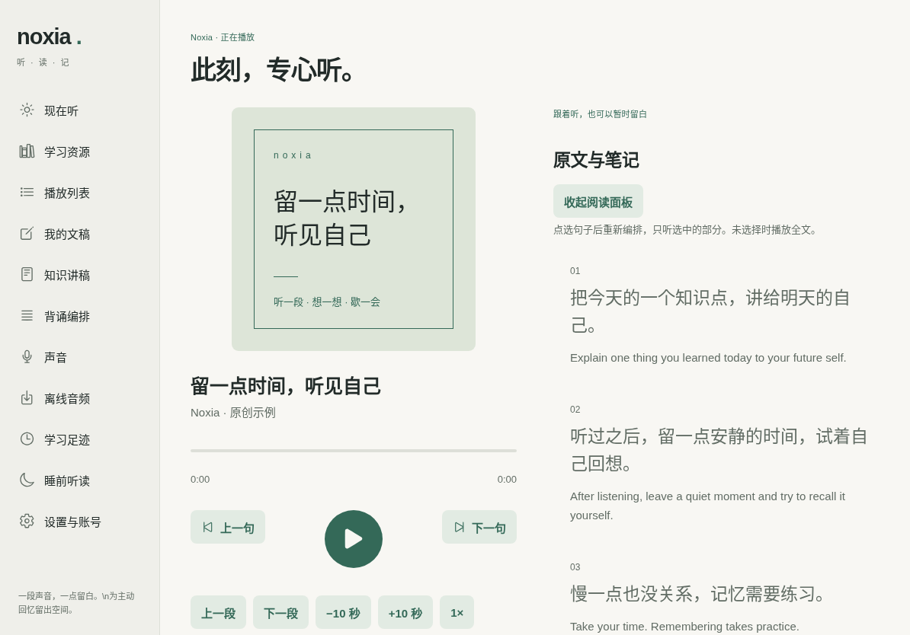

# Noxia

iPadOS 优先的学习听读与主动回忆应用。把文稿、翻译、重复和留白编排成自己的复习节奏。

**当前为 0.1 开发版，未达到全部产品验收。** 可运行 Web 交互版；iOS 原生系统语音缓存、后台播放器及移动账号扩展已有实现，初版已通过 macOS 的原生 Release 模拟器构建，仍需 iPad 实测。没有提供已签名 IPA，不声称锁屏播放已验证。仓库目前保持私有；GitHub 链接和克隆需要拥有访问权限。用户已创建仓库，原生编译结果以 Actions 实际运行为准。不要用 Expo Go 验收原生音频。



这是实际应用的浏览器截图，**不是 iPad 真机或原生模拟器截图**。另见 [首页](docs/screenshots/home-landscape.png)、[竖屏](docs/screenshots/player-portrait.png)、[分屏深色](docs/screenshots/player-split-dark.png)。

## 目前能做什么

- 本机文稿输入、编辑、TXT / Markdown 导入。按用户明确的换行建立朗读单元，Tab 显式对应译文。
- iPad 横屏侧边栏与封面／阅读双栏，窄分屏和手机采用单栏；浅深色、减少动态效果、可收起阅读区。
- 逐句、逐段、全文模板；原文、译文、解释、自定义文字、关键词、静音与留白；步骤重复、语速、音量、声音、排序和开关。
- 选句／重点句播放，留白自背、模板 JSON 导入导出、本机播放列表与学习历史。支持整列表随机顺序、有限次数、逐条模板／音色／语速，准备后跨篇由原生时间线切换。
- Apple 系统语音渲染本地 PCM CAF，再由 AVPlayer 播放完整编排时间线；重复复用音频，静音也是原生音轨。
- 原生实现播放、暂停、逐句／逐段切换、seek、倍速、全篇循环、锁屏媒体信息、耳机控制、中断处理、原生睡眠截止与渐弱。**这些原生行为尚未经过真机验收。**
- 古诗文／英语项目的固定版本资源适配，下载前须确认个人非商业许可；不打包其内容、作答或学习记录。
- OpenAI、DeepSeek 与自定义 OpenAI 兼容讲稿接口，模型列表、提示词、可编辑结果、会话内请求去重缓存和接口用量显示。资料主动发送第三方前有提示，保存后再朗读。
- Cloudflare 移动网关、复用原账号的私有身份扩展、哈希移动会话、CAS 版本冲突和墓碑的后端实现；客户端先接自建模板的手动同步，云端版本可保留双方导入。**未部署到生产。**

## 架构

```text
App.tsx / src/ui             自适应导航、文稿、编排器、播放器、设置
src/core                    严格模型验证、模板、编排编译、合成缓存身份
src/resources               固定版本适配；显式句序对应；不执行远程 JS
src/services                本地保存、安全凭据、AI、移动网关客户端
modules/noxia-audio          Expo 本地模块：Swift AVSpeech → CAF → AVPlayer
backend                     公共移动网关 + 私有身份扩展 + SQL + 测试
```

[编排引擎](docs/engine.md) · [音频与原生限制](docs/audio.md) · [语音调研](docs/tts-research.md) · [资源许可](docs/resources.md) · [账号安全审查](docs/security.md) · [视觉审查](docs/design-skill-review.md)

当前稳定模板使用 Expo SDK 58、React Native 0.88.1、React 19.3 和 TypeScript 6，具体版本锁在 `package-lock.json`。SDK 58 原生依赖最低 iPadOS / iOS 16.4，需 Swift 6 工具链；iPad mini 6 可使用支持的系统版本。不要直接升级单个 React / RN 包。

## Windows 11 开发与预览

需要 Node.js 24 LTS、Git，无需 iPhone。

```sh
git clone https://github.com/XiaoRui114514/noxia.git
cd noxia
npm ci
npm run web
```

浏览器运行真实编辑、编排、资料保存和前台系统朗读交互。Web Speech 不提供持久音频缓存、精确逐字时间戳或可靠后台播放；浏览器朗读可能按单元重新开始。**Web 与 Expo Go 均不能证明 iPad 锁屏功能。**

```sh
npm run typecheck
npm test
npm run export:web
npm run test:e2e
npm run security:scan
```

E2E 使用 Playwright。有系统 Chromium 会自动使用；否则先 `npx playwright install chromium`。测试内语音桩只验证前台控制流程，不验证音质。启用提交前检查：`git config core.hooksPath .githooks`。

## 获取自行签名的真机 IPA

2026-11-07 已实际完成 [真机 Release 构建](https://github.com/XiaoRui114514/noxia/actions/runs/42342289923)。[下载该次 IPA 产物](https://github.com/XiaoRui114514/noxia/actions/runs/42342289923/artifacts/13561807817)（私有仓库需登录，保留7天）：版本0.1.0、ARM64、最低 iPadOS 16.4，待使用你自己的签名。

如果你已有签名方式，使用仓库 Actions 中的 **Build iPad IPA for personal signing**。它用 `iphoneos` SDK 对实体设备 ARM64 执行 Release archive，再打包 `Payload/Noxia.app` 为 `Noxia-unsigned.ipa`；不需要向仓库上传 Apple ID、证书、描述文件或任何签名服务凭据。

在成功运行的 Artifacts 中下载 **Noxia-iPad-IPA-to-sign**，解压得到 IPA、SHA-256 校验文件与 `BUILD-INFO.json`。用你现有的签名方式签名后再安装到 iPad。构建本身不意味着签名或真机安装已完成。Artifacts 默认保留 7 天；过期后可手动 Run workflow 重新构建。

不要使用 `Noxia-iOS-Simulator.zip` 给实体 iPad 签名，它的 SDK 平台不同。模拟器启动和 XCTest 流程改为手动运行，减少不需要的 macOS 构建；常规检查保持自动执行。

## 在 iPad 上安装

用户目前使用普通 Apple ID，并有自己的签名方式；本次按上节优先交付待自行签名的实体 iPad IPA。环境没有 Apple 签名凭据或连接的 iPad，**没有代为签名或完成真机安装**。下面 EAS / TestFlight 是可选分发路径，并非此 IPA 交付的前置要求。

### Windows → EAS 云构建 → 直接安装

1. 注册／登录 Expo 账号，安装依赖后执行 `npx eas-cli@27.5.0 login`、`npx eas-cli@27.5.0 build:configure`，将自己的 EAS project ID 加入配置。Bundle ID 如冲突，改为自己团队拥有的标识。
2. 标准 EAS iOS 真机签名／Ad Hoc 分发通常需要有效的 **Apple Developer Program** 会员、团队权限和签名材料；不能凭普通免费 Apple ID 在 Windows 直接安装任意 IPA。会员费用、EAS 构建额度与队列以各官方当前套餐为准，本项目不会代为购买。
3. 执行 `npx eas-cli@27.5.0 device:create`，用 **iPad 的 Safari** 打开注册链接登记这台 iPad 的 UDID。无需 iPhone。
4. 执行 `npm run build:ios` 生成 `preview` 内部分发构建，按 EAS 指引配置证书与包含该 iPad 的 provisioning profile。在 iPad 打开完成后的签名安装链接；开发者模式要求依系统和签名类型处理。
5. 如需热更新本地开发交互，构建 `development` profile，运行 `npx expo start --dev-client` 并在同网络的 iPad 打开开发客户端。`preview` 是独立 Release 应用，不需要一直开开发电脑。

官方：[EAS iOS 内部分发](https://docs.expo.dev/build/internal-distribution/)、[设备登记](https://docs.expo.dev/build/internal-distribution/#manage-devices)、[Apple 会员](https://developer.apple.com/programs/enroll/)。构建额度不代表永久免费，未在本次任务开启收费服务。

### TestFlight

需要 Apple 开发者团队、App Store Connect 应用、发行签名和上传权限。使用 `production` profile 构建，再通过 EAS Submit 或 Apple 工具上传。外部测试可能需 Beta 审核；构建通常有 90 天有效期。iPad 可以直接安装 TestFlight，无需 iPhone。

### 旧 Intel Mac

仅当可安装当前 SDK 所需 Xcode、系统与 CocoaPods 时，可 `npx expo run:ios --device`。免费个人团队签名的本地安装受 Apple 限制，通常需周期性重签，不能当作长期分发。旧 Mac 不满足要求时使用 EAS；不要求升级这台 Mac。

### 不需要 Apple 账号的原生编译检查

仓库包含 macOS GitHub Actions 的 unsigned iPad simulator Release 编译流程。它能检查 Swift／Pods／JS 打包，**输出不能安装到真实 iPad**，也不能验证锁屏、中断或签名。执行结果见 Actions，不把“工作流存在”写成“构建通过”。

## 免费语音

默认 Apple 已安装的中文／英语声音，不收取额外云端 TTS API 费。可以在 iPad 系统辅助功能的阅读／朗读设置中下载高质量声音，然后在 Noxia「声音」刷新选择。

首次生成保持应用在前台；完成后再锁屏收听。没有安装的音色会报错提示重选。系统音色是否完全离线、古诗文多音字和中英混读效果必须按设备试听。原文与译文可选不同声音，支持本次会话读音替换词典。

缓存键含声音、模型／实现版本、系统版本、文本、语速、音量与读音字典；改变重复次数不重复生成。缓存仅保存在本机应用支持目录，不备份音频到云、不进入 D1。清理缓存会停止播放，不删文稿。

Kokoro、sherpa-onnx、MeloTTS、CosyVoice、Fish Speech 的调研见 [TTS 对比](docs/tts-research.md)。**没有打包模型权重，也没有把未集成模型标成可用。** 不使用 Cookie、私人接口或滥用试用额度的免费语音。OpenAI / Azure / ElevenLabs / Google 云 TTS 只保留扩展设计，尚未接入。

## 模型 API

「设置与账号」选择 OpenAI、DeepSeek 或填写可信的 HTTPS Base URL、模型 ID、个人 API Key。iPad 使用 Keychain；Web 预览仅保存本次会话内存。不要在 `.env`、`EXPO_PUBLIC_*`、GitHub Secrets 之外的公开配置、同步资料或示例中填写真实密钥。

这里是**文本模型**设置，与语音合成分开。DeepSeek 用来生成讲稿，不假定提供 TTS。供应商可能收费，按各自价格与账单核对；本版只显示接口报告的 tokens，不估算虚假金额。不自动请求麦克风或后台录音。

## Cloudflare 部署

先阅读 [部署与生产变更流程](docs/cloudflare.md)。`backend` 是独立包：

```sh
cd backend
npm ci
npm test
npm run check
```

最后一条是 dry-run，**不是部署**。公开网关绑定原私有身份 Worker，复用原 `users`；独立移动 bearer，不把原 Worker 开放公网，不把浏览器 Cookie 当 App token。身份 D1 只增移动会话表，Noxia 小型结构化数据使用独立 D1，音频保留设备。

真实生产接入必须先备份、验证可恢复、在 staging 保持旧网站认证兼容，再取得用户对具体生产改动的确认。所有发布门禁默认关闭；示例数据库 ID 必须替换。未配置时 App 仍可本地学习。现有密码 PBKDF2 10k 的不足及加固兼容性见安全审查，不能静默更改破坏旧账号。

## 验证与已知限制

本次可重现验证记录见 [开发进度](docs/status.md)；CI 结果以 [Actions](https://github.com/XiaoRui114514/noxia/actions) 为准。

- 真机安装、系统语音听感、长时间锁屏播放、耳机、系统中断、多音频输出、断网／内存、Dynamic Type、VoiceOver、Stage Manager 与多窗口均待真机测试。布局只是用浏览器按 iPad 尺寸检查。
- 原生 Swift 已通过 [首次远程 Release 构建](https://github.com/XiaoRui114514/noxia/actions/runs/42341080976)（Xcode 26.6 / Swift 6.3.3）。无签名模拟器应用不能安装到实体 iPad，启动及音频测试见后续 Actions。
- 完整播放列表与留白先准备为原生时间线，跨篇不依赖前台 JavaScript；其后台表现仍未真机验证。首次合成须保持前台。
- 已实现每条独立模板／音色／语速、随机顺序、全篇／全列表 1—20 次及循环。单句／单段循环通过选句和循环组合；没有独立的多层循环面板。
- PDF 提取、扫描 OCR、录音背诵、ASR、开源模型端侧推理、付费 TTS provider、云音频以及真正的多窗口 scene 尚未实现。
- 目前字幕为句段高亮，不是逐字时间戳。播放进度按本篇模板时间线记录；关闭应用后先恢复当前篇，完整列表会话恢复待完善。改变模板后宜重新开始。后台跨多篇的完整学习历史尚待专门验证。
- 本地采用 AsyncStorage；大量文稿、全文检索、数据库迁移、资料备份导出、缓存配额／逐项清理仍待完善。清除 App／浏览器数据会丢失本机资料。
- 账号后端未部署；客户端仅提供模板的显式手动创建／读取及保留双方导入，不宣称所有资料已实现自动双向同步。
- Android 保留 TypeScript 编排与 provider 边界，但原生后台音频未实现，不能当 Android 完成版使用。

## 开源

自主代码采用 [MIT](LICENSE)。两个学习项目的资料、系统声音及各 TTS 权重不受本仓库 MIT 许可覆盖，也没有随仓库分发。详见 [第三方声明](THIRD_PARTY_NOTICES.md)、[隐私](PRIVACY.md)、[安全](SECURITY.md)。设计复核参考 Damir Sokolovsky 的 [unslop](https://github.com/heydamir/unslop)（CC BY 4.0），未执行其安装或 story 服务脚本。
