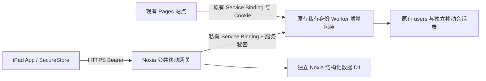

# Cloudflare 统一账号与移动同步

## 当前交付状态

提供可打包的移动 API 网关、已有身份 Worker 的增量包装模块、两份独立 SQL 和自动化测试；**尚未部署到 Cloudflare，也未验证真实账号登录**。默认 `MOBILE_RELEASE_VERIFIED=false`，缺少绑定、秘密或身份发布门禁时返回 503。本地学习不应因此受阻。

2026-11-06 只读审查：

- [poetry-recite](https://github.com/XiaoRui114514/poetry-recite/tree/47dee16aea10c547a61adfbffcef52385d08995f/cloud-sync-backend)：Worker、schema、迁移、测试、wrangler 配置、README。
- [english-grammar-lab](https://github.com/XiaoRui114514/english-grammar-lab/tree/b7bf67996c7862664a346053c4d801ba83bf9fcf)：Pages `functions/api/[[path]].js`、`src/cloud.js`、`src/cloud-sync.js`、`src/cloud-data.js`。
- 现有语文 Pages 代理与客户端使用同一套协议。未改动这两个项目的任何文件、历史或线上配置；没有读取真实数据库或学习记录。

## 信任边界



用户账户仍只有原来的 `users` 表。Noxia 数据库不复制账号、密码摘要或浏览器会话。身份扩展以原有 `credential_version` 检查每次移动访问，原网站恢复密码提升版本后，旧移动会话立即失效。原有浏览器 Worker 完整保留并接收原来的 `/api/*` 请求。

移动会话为 256 位随机 bearer，D1 仅保存 SHA-256 摘要，7 天过期；无长期 refresh token，过期需要再次登录。App 仅将令牌放入设备安全存储，密码仅用于当前 HTTPS 登录，不保存。退出时先撤销服务端会话；离线退出也必须删除本机令牌，并说明服务端会话将在到期前仍有效。浏览器 Cookie 不转换成移动 bearer，也不暴露原私有 Worker。

网关拒绝 Cookie 和带 Origin 的浏览器请求，不添加 CORS 通配。内部接口要求独立的 256 位服务秘密：网关的 `IDENTITY_SERVICE_SECRET` 与身份服务的 `MOBILE_SERVICE_SECRET` 值相同，必须与现有 `PASSWORD_PEPPER` 完全分离。客户端不能持有任何服务秘密。App 也不能使用现有 Pages Cookie 代理作为移动端登录捷径。

## API

网关公开域名由部署者设置；必须 HTTPS。除登录外使用 `Authorization: Bearer <token>`。同步还必须有 `X-Account-ID`，且等于令牌账户。

| 请求 | 内容 | 响应 |
|---|---|---|
| POST `/v1/auth/login` | `{username,password}` | `{user:{id,username},accessToken,expiresAt}` |
| GET `/v1/auth/me` | bearer | `{user,expiresAt}` |
| POST `/v1/auth/logout` | bearer | `{ok:true}`；重复退出安全 |
| GET `/v1/sync/:collection?after=:id` | bearer、账号头 | `{items:[{id,version,deleted,updatedAt}],next}`；每页 100 条，包含墓碑 |
| GET `/v1/sync/:collection/:id` | 同上 | `{id,version,data,deleted,updatedAt}`；不存在时 `version:0` |
| PUT `/v1/sync/:collection/:id` | 同上及 `{baseVersion,deleted,data}` | 更新后的记录 |

`:collection` 为 `resources`、`playlists`、`templates`、`history`。ID 为 1–128 位字母、数字、`_`、`-`。单条 JSON 内容不超过 64 KiB；结构深度 16、节点数 4,000。顶层白名单与嵌套凭据键拒绝逻辑见 `backend/src/worker.mjs` 的 `validateEntity`。资源大文档保留本机，不截断上传；音频不进 D1。

创建 `baseVersion:0`；修改、删除使用上次读取的版本。删除必须 `{baseVersion:N,deleted:true,data:null}`。写入依靠 SQL 原子比较更新；冲突 `409 {error:'conflict',current:...}`，客户端必须先把本机和云端版本各自保存，提供人工选择或复制为新条目，禁止无提示覆盖。墓碑暂不清理，避免离线设备复活已删数据。

列表接口是完整版本清单分页，不是基于客户端时间的增量事件流。客户端逐条比较版本、取回有变动的记录；分页时发生新增应在下一轮重新扫描，从而收敛，不声称跨页强快照一致性。多设备不能把“听过”合并成“已掌握”。

App 应将匿名及每个登录账号的数据分区保存，异步请求携带启动时的 owner 与 generation；换号后丢弃旧响应。首次上传私人材料必须显式选择，默认保留本机。服务端字段检查不能识别用户把秘密写进正文的情形。

## 本地验证

Node.js 24（测试使用内置 SQLite；同时满足当前 Vitest/Wrangler 要求）：

```sh
cd backend
npm ci
npm test
npm run check
```

测试使用内存 SQLite 与虚构密码、用户和令牌，覆盖 SQL CAS、账号隔离、删除墓碑、分页、嵌套秘密拒绝、大小限制、共享限流、令牌摘要、到期、撤销、发布门禁、内部边界和旧浏览器路由。`check` 仅 `wrangler deploy --dry-run`，没有部署或访问真实 D1；它不证明生产 CPU 配额或 Service Binding 权限。

## 待授权的生产接入

以下内容供审查；本次没有执行。不能把 README 里的命令当成生产变更批准。

1. 用户持有人确认 Cloudflare 账户与 Workers/D1 权限；列出现有部署和套餐，确认不会自动启用付费。记录当前 Worker 版本、现有 Pages 绑定与变量。
2. 在受控私有位置导出原 D1 备份，验证可恢复及表结构；备份绝不进入本仓库。用本地或 staging 数据库恢复并跑旧认证、双站同步、恢复撤销与并发测试。
3. 将 `backend/identity-extension/common.mjs`、`mobile-extension.mjs` 复制到原身份 Worker 的 `src/`。`entry.example.mjs` 作为新入口（相邻的原 `worker.js` 保持不变）；先在隔离分支 dry run 和原测试。不要把 Noxia 网关的 wrangler 配置复制覆盖原身份配置。
4. 审查 `identity-extension/0001-mobile-sessions.sql`，这是给**已有身份 D1**加移动会话表的唯一 SQL；`migrations/0001-noxia.sql` 仅用于**新的 Noxia 数据 D1**。不重建 `users`，不修改旧 `sessions`、`learning_data` 和密码参数。
5. 展示备份/恢复与 staging 结果、精确迁移、配置 diff、回滚步骤，取得用户对生产数据库和认证入口变更的明确确认后再执行。原身份 Worker 必须继续 `workers_dev:false`、`preview_urls:false`，不挂公共 route。
6. 通过 Cloudflare secret 管理安全写入两端的同一服务秘密，保留原 pepper；身份配置新增 `MOBILE_AUTH_RELEASE_VERIFIED=false`。不可在终端、聊天或日志打印值。
7. Noxia 网关绑定原身份服务和新 D1；替换示例数据库占位 UUID，在网关自己的自定义域设置公开路由。现有身份服务仍是私有。先保持两个移动门禁关闭。
8. staging 验证通过后，仅在获批范围内开启身份和网关移动门禁。用新建的合成测试账号验证真实绑定、登录、退出、恢复撤销、跨设备冲突、断网保留与真实 CPU。不能利用用户私人记录做公开测试。
9. 回滚时先关移动门禁、撤下公共移动 route，再恢复原身份入口；不删除账号/学习数据，保留增量表以便审计。迁移未改旧表，所以原网站无需依赖移动数据表。

当前缺少 Cloudflare 凭据及生产授权，以上均待完成。强密码哈希升级须采用 `docs/security.md` 的单独兼容迁移，不与首次移动端接入绑在一起。
